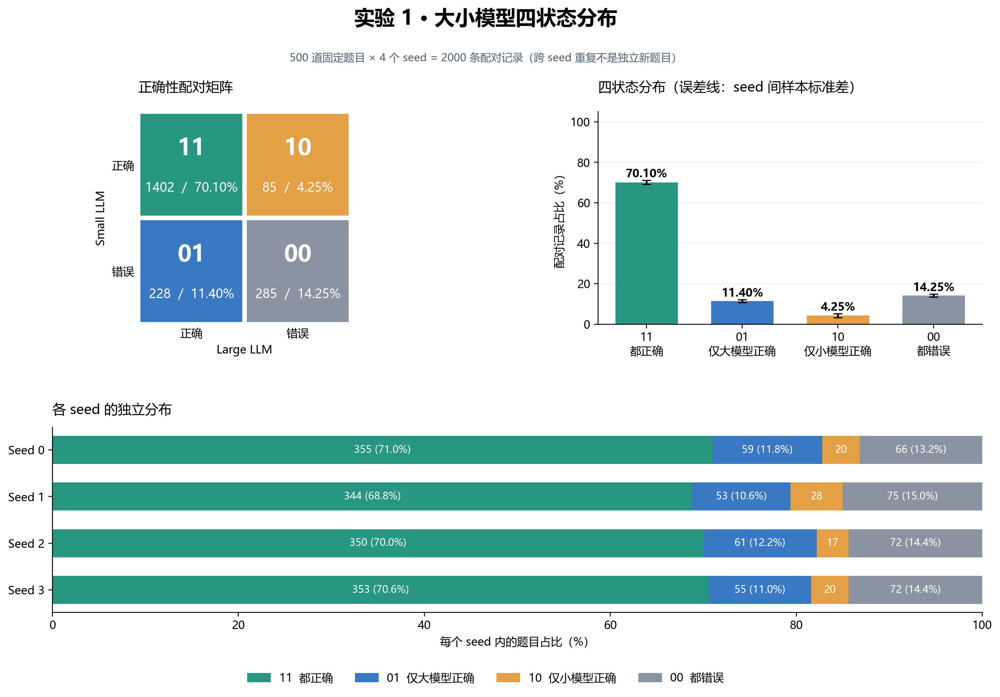

# STEER · MATH500 复现与文献汇报

围绕 AAAI 2026 论文 *Confidence-Guided Stepwise Model Routing for Cost-Efficient Reasoning*，整理 Qwen2.5-Math **1.5B / 7B** 在 **MATH500** 上的复现代码、结果分析与中文汇报。

这是个人复现项目。上游固定版本：`04f5ad59bafa394b449f3e74e1b0529667a02cc7`；范围为一个模型对与一个基准，尚未完成全论文、多基准或 xVerify 结果复现。

## 阅读入口

| 内容 | 入口 |
|---|---|
| 文献汇报 | [核对版 PPT](slides/STEER_literature_and_reproduction.pptx) · [PDF](slides/STEER_literature_and_reproduction.pdf) · [逐页提纲与修订记录](slides/README.md) |
| 环境与运行 | [复现指南](docs/reproduction.md) · [代码目录](STEER_MATH500/) |
| 三种方法主对照 | [结果报告](reports/main/report.md) · [逐 seed CSV](reports/main/per_seed.csv) |
| 实验 1：大小模型四状态 | [报告](reports/experiment1/report.md) |
| 实验 2：一致性代理与状态稳定性 | [报告](reports/experiment2/report.md) |
| 论文与相关工作 | [文献索引](references/README.md) · [BibTeX](references/references.bib) |
| 文件选择、代码差异与结果来源 | [整理说明](docs/organization.md) · [版本记录](provenance/code-versions.json) |

## 主结果

共同 seed **0–3**，每轮为相同的 **500 题**；规则评测准确率，均值 ± seed 间样本标准差。

| 方法 | Accuracy（%）↑ | 生成 FLOPs/题（T）↓ |
|---|---:|---:|
| Small · 1.5B | 74.35 ± 0.68 | 1.6790 ± 0.0358 |
| Large · 7B | 81.50 ± 1.48 | 10.7990 ± 0.3242 |
| STEER | 78.15 ± 1.20 | 4.6791 ± 0.5579 |

STEER 相对 small 提高 **3.80 个百分点**；相对 large 下降 **3.35 个百分点**，估算生成 FLOPs 节省 **56.67%**。FLOPs 为 2N/token 近似，不是耗时或能耗；两种推理入口的 token 预算语义不同，不能视为严格等预算对照。

## 后续分析



四个 seed 的 2000 条配对记录中：都对 **70.10%**、仅大模型对 **11.40%**、仅小模型对 **4.25%**、都错 **14.25%**。这些是 500 道题的重复采样，不是 2000 道独立题。

实验 2 使用留一 seed 的答案一致率代理，高一致率预测 01 的 AUROC 为 **0.4859**，按题目聚类 bootstrap 95% 区间 **[0.4292, 0.5433]**。该代理未显示可靠区分能力；它依赖多次生成，且不是真正的 logits / 序列概率置信度。

## 快速检查

无需 GPU，可重算仓库内发布统计：

```bash
python scripts/verify_published_results.py
cd STEER_MATH500
python run.py --method all --samples 10 --dry-run
python -m pip install -r requirements-analysis.txt
python -B -m unittest discover -s tests -v
```

完整推理需 Linux、Python 3.10 和兼容的 NVIDIA CUDA 环境；STEER 需要两张可见 GPU。安装及全量运行见复现指南。

## 来源与许可

[STEER 论文](https://doi.org/10.1609/aaai.v40i37.40413) · [arXiv](https://arxiv.org/abs/2511.06190) · [官方代码](https://github.com/helmsman12/STEER)。源码沿用上游 Apache-2.0 及组件原许可证，见 LICENSE 和各组件目录。论文图表、数据和参考文献按其各自来源归属；汇报页标明引用。

整理日期：2026-11-11。模型权重、完整推理输出、日志、缓存、连接凭据和历史预览未纳入版本库。
