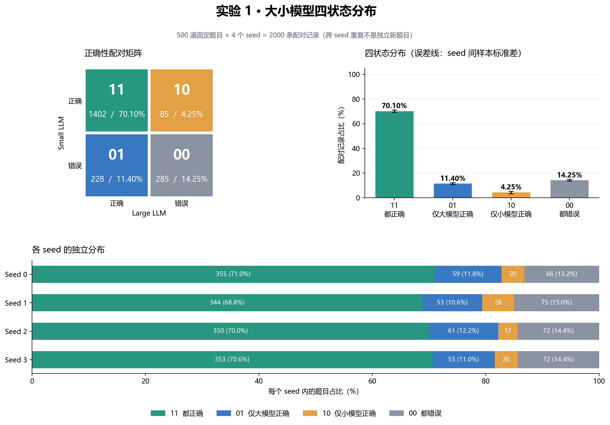
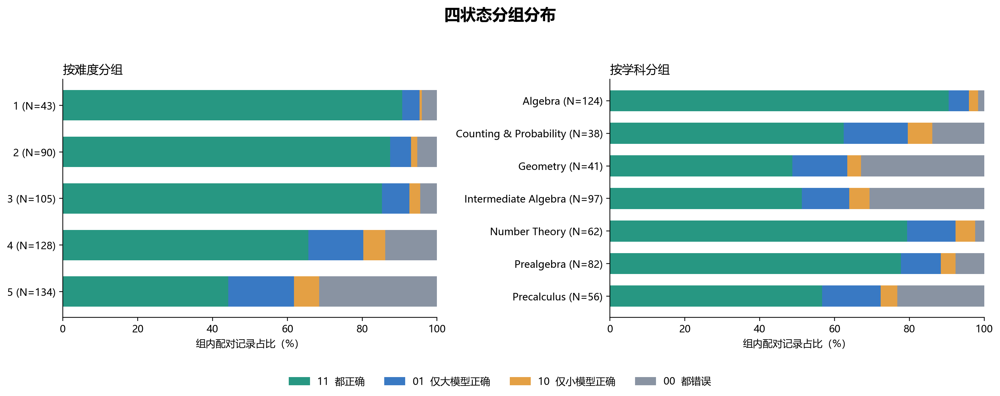

# 实验 1：大小模型四状态分布

固定题目数：500；seed：[0, 1, 2, 3]；配对记录数：2000。
每道题由两个模型独立生成完整回答；第一位是 Small，第二位是 Large。
复用原实验保存的规则评分，不重新推理、不重新评分。

| 状态 | 含义 | 配对记录数 | 占比 | seed 间占比样本标准差（百分点） |
|---|---|---:|---:|---:|
| 11 | 都正确 | 1402 | 70.10% | 0.96 |
| 01 | 仅大模型正确 | 228 | 11.40% | 0.73 |
| 10 | 仅小模型正确 | 85 | 4.25% | 0.94 |
| 00 | 都错误 | 285 | 14.25% | 0.75 |

## 分析指标

- 小模型准确率：**74.35%**；公式：`(11 + 10) / 全部`。
- 大模型准确率：**81.50%**；公式：`(11 + 01) / 全部`。
- 小模型错题中大模型答对比例：**44.44%**；公式：`01 / (01 + 00)`。
- 小模型对题中大模型答错比例：**5.72%**；公式：`10 / (11 + 10)`。
- 完整答案事后择优准确率上界：**85.75%**；公式：`(11 + 01 + 10) / 全部`。
- 大模型相对小模型净变化：**+7.15 个百分点**；公式：`(01 − 10) / 全部 × 100`。

## 各 seed

| seed | 题目数 | 11 | 01 | 10 | 00 | Small Acc | Large Acc |
|---|---:|---:|---:|---:|---:|---:|---:|
| 0 | 500 | 355 | 59 | 20 | 66 | 75.00% | 82.80% |
| 1 | 500 | 344 | 53 | 28 | 75 | 74.40% | 79.40% |
| 2 | 500 | 350 | 61 | 17 | 72 | 73.40% | 82.20% |
| 3 | 500 | 353 | 55 | 20 | 72 | 74.60% | 81.60% |

## 跨 seed 的题目稳定性

- 所选 seed 中始终为 01 的题目：10。
- 所选 seed 中始终为 00 的题目：41。
- 逐题状态计数见 question_stability.csv；单 seed 只能描述一次观测。

## 解释范围

- 01 表示这次独立完整回答中大模型答对、小模型答错；不证明在某个中间步骤升级就能救回。
- 00 表示本次两份回答都错，不能推断增加采样、改变提示词或步骤切换仍无法解决。
- 11 表示小模型本次已答对；10 表示大模型也可能失去小模型本次答对的题。
- 事后择优上界假定已知两份回答的正确性，不是可部署路由器的实测准确率。
- 多 seed 是同一组题的重复采样；配对记录不是更多独立题目，误差线不是置信区间。
- 规则评分可能有误判和超时；评分超时、后端和可用模型 revision 见 checks.json。
- 只检查已记录的模型来源；没有重新核验权重字节。

## 图表

发布版精选 PNG 与统计表；完整回答、原始日志和重复图表格式留在工作档案。
