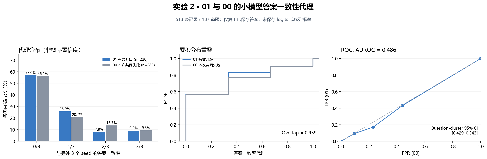
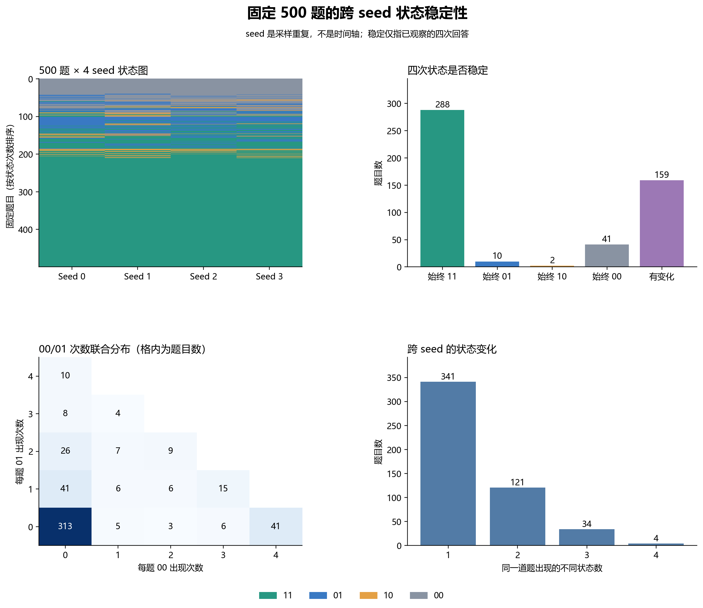

# 实验 2：01/00 区分能力与跨 seed 状态稳定性

## 数据与置信度可用性

来源是实验 1 从服务器只读下载的 small/large seed 0–3 原始逐题文件；没有重新生成、重评分或训练路由器。
仅对 01/00 计算 AUROC：01=228，00=285，合计 513 条，涉及 187 道题。
小模型记录数 2000；未保存 token logits、token logprob 或序列概率。基线生成入口也没有请求 logprobs，不能从现有文本反推出真正的概率置信度。

因此本次是**答案一致性代理实验**，不能直接作为论文 logit 置信度的 H1 检验。

## 预先定义的代理

对题目 q、seed s，把小模型提取答案删除空白后，与另外三个 seed 的小模型答案比较：
`proxy(q,s) = 与当前答案相同的其他 seed 数 / 3`。
自身 seed 不投票；特征不读取标准答案、Small/Large score、大模型答案或四状态标签。
仅以字符串相同判定一致，不进行数学等价化；等价但写法不同会被记为不一致。空答案记缺失，不能把两个空答案当作高一致性。
可用 513 条，缺失 0 条。
该代理需要同题四次小模型生成，是事后多采样分析，不是单次生成即可部署的路由特征；没有使用模型生成的自评信心。

## 分布与 AUROC

正类固定为 01；默认方向为一致率越高越预测 01，同时报告反方向，不能根据标签选择方向后只报告较好的一边。

| 与另外三个 seed 相同的票数 | 01 数量 | 01 类内占比 | 00 数量 | 00 类内占比 |
|---|---:|---:|---:|---:|
| 0/3 | 130 | 57.02% | 160 | 56.14% |
| 1/3 | 59 | 25.88% | 59 | 20.70% |
| 2/3 | 18 | 7.89% | 39 | 13.68% |
| 3/3 | 21 | 9.21% | 27 | 9.47% |

- 高一致率预测 01：AUROC **0.4859**；按题目聚类 bootstrap 95% 区间 **[0.4292, 0.5433]**。
- 低一致率预测 01：AUROC **0.5141**；区间 **[0.4567, 0.5708]**。
- 离散分布重叠系数：**0.9395**；定义为 `sum_v min(P(proxy=v|01), P(proxy=v|00))`，范围 0–1，越大越重叠。
- bootstrap 重采样 2000 次，随机种子 0；每次重采样 500 道完整题目，再取 01/00。
- 同题四个 seed 一起重采样，区间描述题目重采样下的稳定性，不把 513 条记录当作独立题目；没有额外估计新 seed 的变异。

| seed | 01 | 00 | 高一致率预测 01 AUROC | 低一致率预测 01 AUROC |
|---|---:|---:|---:|---:|
| 0 | 59 | 66 | 0.5657 | 0.4343 |
| 1 | 53 | 75 | 0.4244 | 0.5756 |
| 2 | 61 | 72 | 0.4903 | 0.5097 |
| 3 | 55 | 72 | 0.4616 | 0.5384 |

## 跨 seed 的状态稳定性

每道题完整保留 seed 0、1、2、3 的四状态；seed 是采样重复，不能解释为时间上的能力演化。

| 题目类别 | 题目数 |
|---|---:|
| 四次始终 11 | 288 |
| 四次始终 01 | 10 |
| 四次始终 10 | 2 |
| 四次始终 00 | 41 |
| 状态有变化 | 159 |
| 合计 | 500 |

四次均为 00 的题目 **41** 道；一次 00、三次 01 的题目 **4** 道。
具体题号、问题、四次状态与次数见 question_state_patterns.csv；两类例子分别导出 stable_00_questions.csv 和 one00_three01_questions.csv。
这些是有限四次观察下的稳定性，不构成不可解证明；同一题的改变也可能来自评分或采样差异。

## 对 H1 的解释

当前代理的区分证据不足：高一致率方向的 AUROC 区间覆盖 0.5。结合分布重叠，应报告“该离线答案一致率代理未显示可靠的有效升级识别能力”。
这既不能证明真正的 logits/序列概率置信度无效，也不能证明复杂路由器有必要。H1 对真正概率置信度仍待验证。
若要直接检验 H1，下一步应对已保存的小模型回答补算 teacher-forced token/序列概率并单独记录口径，或在新生成实验中保存这些值；本次没有执行模型评分。
后续比较问题特征或升级收益估计时，应按题号划分训练/测试集，同题不同 seed 不能跨集合泄漏。

